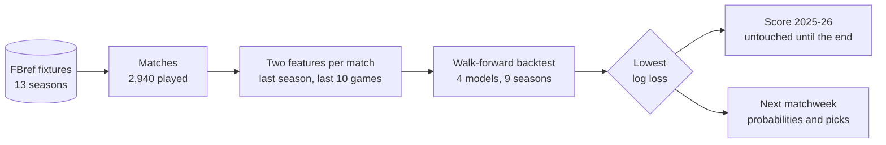
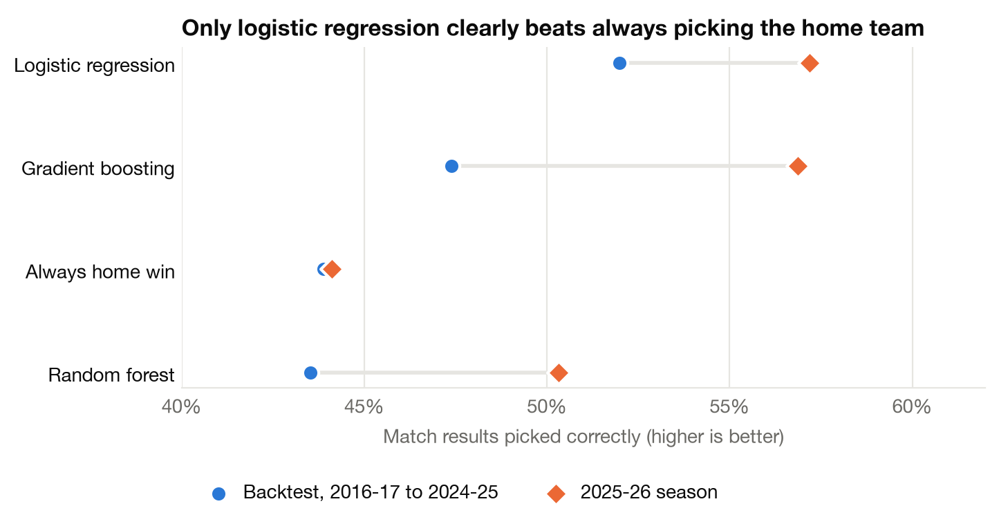
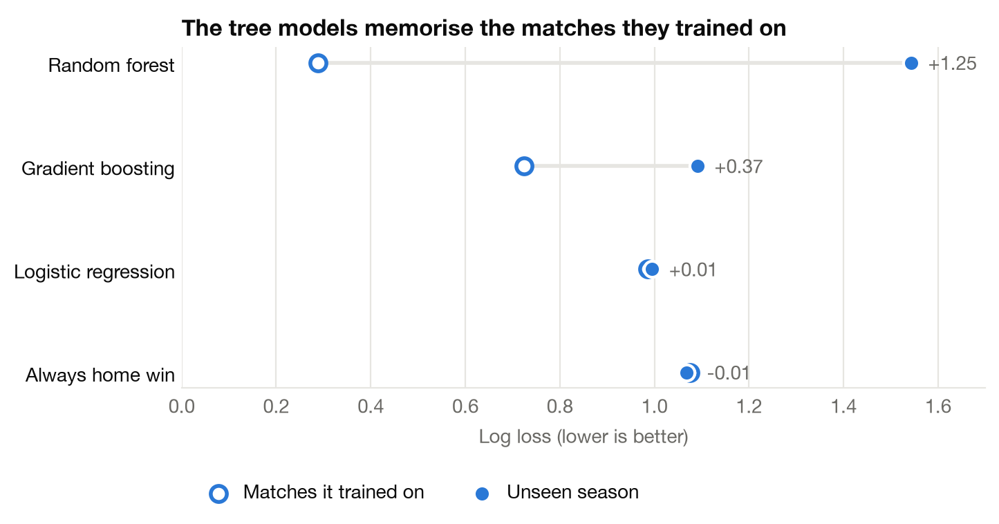
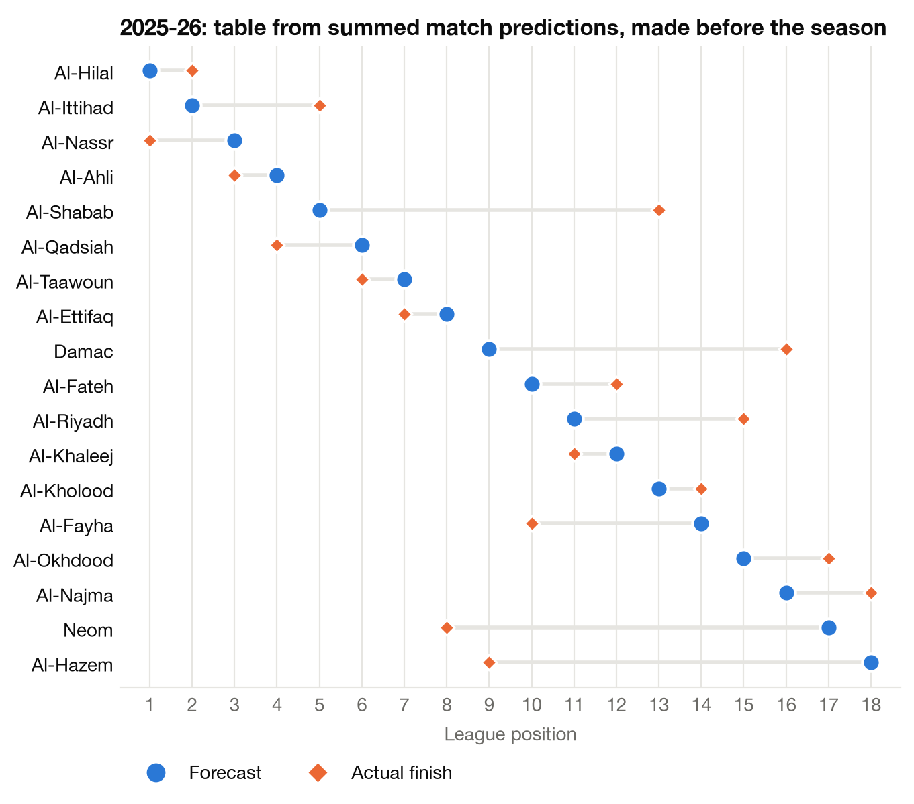

# Saudi Pro League match predictor

[](https://github.com/sal2049/saudi-pro-league-forecast/actions/workflows/ci.yml)

Before a Saudi Pro League match kicks off, can you say whether it will end in
a home win, a draw or an away win? This project tries, using every league
match since 2014-15, and predicts each matchweek one at a time.

The short answer: a little better than guessing. Always picking the home team
is right **44%** of the time. A logistic regression on two simple numbers is
right **52%** of the time across nine test seasons, and **57%** on the
2025-26 season, which played no part in building it. It never predicts a
draw, and draws are almost a quarter of all matches.

## The question, as an ML problem

- **Type:** supervised classification with three classes: home win (H), draw
  (D), away win (A).
- **One row:** one match. 2,940 played matches, 2014-15 to 2026-27 so far.
- **Inputs:** two numbers, both known before kick-off.
  - `last_diff`: home team's goal difference per game last season, minus the
    away team's.
  - `form_diff`: the same, over each team's last 10 league matches.
- **Output:** three probabilities that add up to 1. The pick is the most likely
  of the three.



## Results

Accuracy is the share of matches whose result was picked correctly. Log loss
scores the probabilities themselves: lower is better, and it punishes being
confidently wrong.

| Model | Accuracy, backtest<br/>(2,176 matches) | Log loss,<br/>backtest | Log loss on<br/>training matches | Accuracy,<br/>2025-26 (306) | Log loss,<br/>2025-26 |
|---|:---:|:---:|:---:|:---:|:---:|
| Always home win (baseline) | 43.9% | 1.068 | 1.075 | 44.1% | 1.064 |
| **Logistic regression** | **52.0%** | **0.995** | 0.986 | **57.2%** | **0.902** |
| Gradient boosting | 47.4% | 1.091 | 0.725 | 56.9% | 0.935 |
| Random forest | 43.5% | 1.543 | 0.288 | 50.3% | 2.012 |

Logistic regression was chosen before 2025-26 was scored, by the lowest
backtest log loss. Across all ten test seasons it picks **8.7 percentage
points** more results correctly than always picking the home team (95%
interval 6.6 to 10.8, from a paired bootstrap over matches).



What I take from this:

- **A small, real edge.** Two numbers about each team's strength move
  accuracy from 44% to about 52%. That is the whole gain.
- **The flexible models overfit.** The random forest has a log loss of 0.29 on
  matches it trained on and 1.54 on new ones, and picks fewer results
  correctly than always choosing the home team. Gradient boosting shows the
  same pattern, less strongly.
- **It never predicts a draw.** A draw is never the single most likely result
  for any match: the model's highest draw probability in 2025-26 was 26%.
  So every draw is a miss. This is common for this kind of model.
- **More seasons did not help.** I scraped four extra seasons (2014-15 to
  2017-18). Trained with or without them, the model scores almost the same
  (log loss 0.977 against 0.982, accuracy 52.4% against 52.6%). More rows of
  the same two numbers add little; new kinds of information would.



### Week by week

In 2025-26 the model got **5.1 of 9 results right per matchweek on average**,
with a best week of 8 and a worst of 3.

The prediction for the next matchweek of the current season, made on 27
October 2026 before any of its matches were played:

| Date | Home | Away | Home win | Draw | Away win | Pick |
|---|---|---|:---:|:---:|:---:|---|
| 29 Oct | Al-Khaleej | Al-Hazem | 45% | 26% | 29% | home win |
| 29 Oct | Al-Nassr | Al-Kholood | 80% | 15% | 4% | home win |
| 29 Oct | Al-Riyadh | Al-Qadsiah | 10% | 17% | 73% | away win |
| 30 Oct | Abha | Al-Ittihad | 15% | 20% | 65% | away win |
| 30 Oct | Al-Shabab | Al-Ahli | 16% | 21% | 63% | away win |
| 30 Oct | Diriyah Club | Neom | 28% | 25% | 48% | away win |
| 31 Oct | Al-Fayha | Al-Faisaly | 55% | 25% | 20% | home win |
| 31 Oct | Al-Hilal | Al-Fateh | 82% | 14% | 4% | home win |
| 31 Oct | Al-Taawoun | Al-Ettifaq | 37% | 25% | 38% | away win |

Most likely to win that week: Al-Hilal, Al-Nassr, Al-Qadsiah. Re-running
`python -m spl_predictor` after new results are added predicts the next week.

### From matches to a season table

Adding up each club's expected points (3 &times; P(win) + P(draw)) over a
whole season, using only what was known before it started, gives a predicted
table. Over the nine backtest seasons it is **2.68 places off per club**,
against 3.10 for simply keeping last season's order. But it was worse than
that baseline in four of the ten test seasons, including 2025-26 (3.33
against 3.00), so I treat the table as a by-product, not the result.



## How it works

1. **Data** ([data.py](src/spl_predictor/data.py)). One CSV per season of
   FBref fixtures, loaded into one row per match.
2. **Features** ([features.py](src/spl_predictor/features.py)). Walk through
   the matches in date order and record each team's numbers *before* each
   match. A promoted club has no top-flight season to look back on, so it gets
   the average of the previous season's bottom three.
3. **Models** ([models.py](src/spl_predictor/models.py)). A no-skill baseline,
   logistic regression, random forest and gradient boosting.
4. **Backtest** ([evaluate.py](src/spl_predictor/evaluate.py)). For each test
   season, train on all earlier seasons and predict every match of it.
5. **Use** ([forecast.py](src/spl_predictor/forecast.py)). Predict one
   matchweek, rank clubs by their chance of winning that week, or add up a
   whole season.

[docs/architecture.md](docs/architecture.md) has the design decisions and the
guards against data leakage. [notebooks/walkthrough.ipynb](notebooks/walkthrough.ipynb)
runs the same steps with the intermediate tables on show.

## How this project got here

It started as a data mining course project that treated the final league
position as one of 18 classes and reported a KNN classifier as 2.47 places
off. That number came from choosing the best of eight models on a single
season. Tested over several seasons it was no better than copying last
season's table.

The second version predicted a club's points per game for the season, a
regression on about 100 club-seasons. It worked, but 100 rows is very little,
and its best feature was an Elo rating that was hard to justify on that data.
This version predicts matches instead. That is about 30 times more examples,
a classification problem with a clear baseline, and it can be checked week by
week. Both earlier versions are in the commit history.

## Limitations

- **Only results.** No squad values, injuries, transfers, line-ups or betting
  odds. Bookmakers' odds would be the real benchmark; I have not compared
  against them.
- **No draws.** See above.
- **Promoted clubs** get a generic guess. Clubs that came up with large
  budgets (Al-Ahli in 2023-24, Al-Qadsiah in 2024-25, Neom in 2025-26) were
  forecast far too low.
- **The league changed.** It grew from 14 to 16 to 18 clubs and changed
  sharply after the 2023 ownership changes. The model weights all seasons the
  same.
- **One awarded match** (Al-Orobah 0&ndash;3 Al-Nassr, 2024-25) is kept as
  the official result.

## Run it

```bash
git clone https://github.com/sal2049/saudi-pro-league-forecast.git
cd saudi-pro-league-forecast
python -m venv .venv && source .venv/bin/activate
pip install -e ".[dev]"

python -m spl_predictor   # backtest, 2025-26 check, next matchweek; rewrites reports/
pytest                    # 11 tests, including a data-leakage test
```

## Repository layout

```
data/matches/         one CSV of FBref fixtures per season
src/spl_predictor/
  data.py             load matches, build league tables
  features.py         the two pre-match features
  models.py           the four candidates
  evaluate.py         walk-forward backtest, metrics, bootstrap
  forecast.py         one matchweek, weekly rankings, a season table
  plots.py            figures
  pipeline.py         runs all of the above
tests/                unit tests
notebooks/            step-by-step walkthrough
reports/              generated tables and figures
docs/architecture.md  design notes
```

## Data

All matches are from [FBref](https://fbref.com/en/comps/70/history/Saudi-Pro-League-Seasons),
collected with Firecrawl. Details are in [data/README.md](data/README.md).
