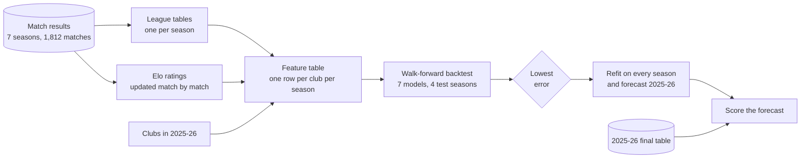

# Saudi Pro League table forecast

[](https://github.com/sal2049/saudi-pro-league-forecast/actions/workflows/ci.yml)

Can you predict next season's league table from past results alone? This
project tries, using seven seasons of Saudi Pro League matches (2018-19 to
2024-25), and then checks its 2025-26 forecast against the table that season
actually produced.

The short answer: a little. The best models finish about **2.5 places off per
club**, against 3.1 for simply copying last season's table and 5 to 6 for a
random guess. With only 100 club-seasons to learn from, the model that held up
best has a single feature, and the more flexible models mostly memorised the
training data.


The forecast above was built from matches up to May 2025. It put the eventual
champions Al-Nassr third (a 19% title chance, behind Al-Hilal at 40%), got
three of the top four right, and 16 of 18 clubs finished inside their 80%
range. Its worst miss was Neom, a newly promoted club it had no history for:
forecast last, finished 8th.

## How it works



1. **Tables.** Matches are rolled up into a final table per season
   ([data.py](src/spl_predictor/data.py)).
2. **Features.** Each club-season gets four numbers that were known before its
   first match: points per game and goal difference per game last season, an
   Elo rating built from every earlier match, and a flag for promoted clubs
   ([features.py](src/spl_predictor/features.py), [elo.py](src/spl_predictor/elo.py)).
3. **Models.** Seven candidates predict next season's points per game; clubs
   are ranked by that prediction ([models.py](src/spl_predictor/models.py)).
4. **Backtest.** Each model is trained on the seasons before a test season and
   scored on that season, for four test seasons in turn
   ([evaluate.py](src/spl_predictor/evaluate.py)).
5. **Forecast.** The backtest winner is refitted on everything and forecasts
   2025-26, with a range for each club from 10,000 simulated seasons
   ([forecast.py](src/spl_predictor/forecast.py)).
6. **Holdout.** Only then is the real 2025-26 table opened and the forecast scored.

[docs/architecture.md](docs/architecture.md) has the design decisions and the
guards against data leakage. [notebooks/walkthrough.ipynb](notebooks/walkthrough.ipynb)
runs the same steps with the intermediate tables on show.

## Results

Error is the average number of places between a club's predicted and actual
position. Lower is better.

| Model | Backtest<br/>(4 seasons) | On its own<br/>training seasons | 2025-26<br/>holdout | Gain over baseline,<br/>all 5 seasons (95% CI) |
|---|:---:|:---:|:---:|:---:|
| Last season's table (baseline) | 3.10 | 3.24 | 2.89 | |
| **Elo** (one feature) | **2.38** | 2.87 | 2.83 | **0.58** (0.17 to 1.04) |
| **Ridge** (four features) | 2.56 | 2.81 | **2.39** | **0.53** (0.19 to 0.91) |
| Random forest | 2.57 | 1.29 | 2.50 | 0.50 (-0.09 to 1.09) |
| KNN regressor | 2.93 | 2.54 | 2.50 | 0.22 (-0.22 to 0.63) |
| Gradient boosting | 2.99 | 0.82 | 2.94 | 0.08 (-0.53 to 0.74) |
| v1: KNN classifier on positions | 2.96 | 2.69 | 3.22 | 0.05 (-0.33 to 0.42) |

What I take from this:

- **Two simple models beat the baseline, by about half a place.** Elo and
  Ridge are the only ones whose confidence interval stays clear of zero.
- **The ranking of models is not stable.** Elo won the backtest and was then
  fourth on 2025-26. Season by season the best model was Elo, Ridge, random
  forest, Elo, Ridge. One season is 16 or 18 data points, which is not enough
  to rank models.
- **Promoted clubs are the main source of error.** For the Elo model the
  average miss is 2.1 places for established clubs and 4.0 for promoted ones.
  The model knows nothing about a promoted side except that it is new.


### Overfitting

The clearest sign of overfitting is a model doing much better on seasons it
trained on than on a season it has never seen.


Gradient boosting is off by 0.8 places on its training seasons and 3.0 on new
ones. The random forest shows the same pattern. Elo and Ridge have no gap at
all, which is what you want from a model fitted on 100 rows.

## What changed from the first version

This started as a data mining course project, a single notebook. It reported
a KNN classifier with an error of 2.47 places. When I went back to it, the
number did not hold up, for reasons that had little to do with KNN:

| First version | Problem | Now |
|---|---|---|
| Eight models compared on one season, and the winner's score on that same season reported | The reported score is the best of eight tries on 15 data points, so it flatters the model | Walk-forward backtest over four seasons, plus 2025-26 kept aside as a final check |
| No baseline | No way to tell if the model had learned anything | "Same as last season" baseline, with a confidence interval on the gain |
| Position treated as 18 separate classes | Throws away the order (2nd is closer to 1st than 15th is) and leaves about five examples per class | Regression on points per game, then rank |
| Scored on the 15 clubs that stayed up; the forecast table included the three relegated clubs and none of the promoted ones | Not a forecast of the real league | Scored on all 18 clubs in the season being predicted |
| Season totals as features | Seasons have 30 or 34 games, so totals are not comparable; the seven features held only four independent facts | Per-game rates, plus Elo |

Scored the new way, the first version's model comes out at 2.96 in the backtest
and 3.22 on 2025-26. That is no better than the baseline. It is kept in the
comparison as `v1` so the two can be read side by side.

## Limitations

- **Small data.** Six seasons with a previous season to learn from, 100 rows.
  Every number above carries wide uncertainty, and the confidence intervals
  treat clubs in the same season as independent when they are not.
- **Results only.** No squad values, transfers, managers or ownership. The
  league changed sharply in 2023 when four clubs came under PIF ownership and
  the league grew to 18 teams; nothing in the features can see that coming.
- **Promoted clubs** get a generic prior. Al-Qadsiah (4th in 2024-25) and Neom
  (8th in 2025-26) were both forecast near the bottom.
- **Elo settings were fixed, not tuned.** As a check, 72 other settings were
  tried afterwards; backtest error ranged from 2.00 to 2.71, always ahead of
  the baseline ([elo_sensitivity.csv](reports/elo_sensitivity.csv)).
- **The tree models run at scikit-learn defaults.** That is what lets them
  memorise. Limited to shallow trees they stop overfitting and land level with
  the linear models (2.38 for the forest, 2.59 for boosting in the backtest),
  so the lesson is about model capacity on 100 rows, not about trees
  ([tree_capacity_check.csv](reports/tree_capacity_check.csv)). I ran this
  after choosing the model, so it is a check and not part of the comparison.
- **Tie-breaks** use goal difference, not the league's head-to-head rule.

## Run it

```bash
git clone https://github.com/sal2049/saudi-pro-league-forecast.git
cd saudi-pro-league-forecast
python -m venv .venv && source .venv/bin/activate
pip install -e ".[dev]"

python -m spl_predictor   # backtest, forecast, holdout score; rewrites reports/
pytest                    # 16 tests, including a data-leakage test
```

Needs Python 3.10 or newer. A full run takes a few seconds and reproduces every
number and figure in this README.

## Repository layout

```
data/
  matches/            one CSV of match results per season
  holdout/            2025-26 club list and final table
src/spl_predictor/
  data.py             load matches, build league tables
  elo.py              match-by-match Elo ratings
  features.py         one row per club-season, pre-season information only
  models.py           the seven candidates
  evaluate.py         walk-forward backtest, metrics, bootstrap
  forecast.py         forecast, simulated ranges, holdout scoring
  plots.py            figures
  pipeline.py         runs all of the above
tests/                unit tests
notebooks/            step-by-step walkthrough
reports/              generated tables and figures
docs/architecture.md  design notes
```

## Data

Match results were collected from [FBref](https://fbref.com/) with Firecrawl.
The 2025-26 final table is from
[Wikipedia](https://en.wikipedia.org/wiki/2025%E2%80%9326_Saudi_Pro_League),
checked against [RSSSF](https://rsssf.org/tabless/sau2026.html). Details are
in [data/README.md](data/README.md).
