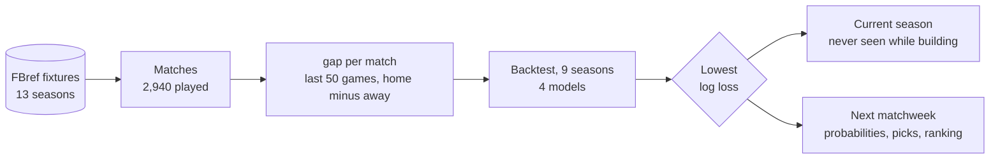
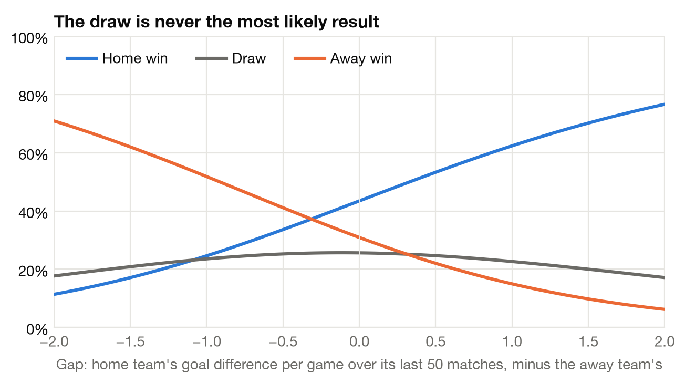

# Saudi Pro League match predictor

[](https://github.com/sal2049/saudi-pro-league-forecast/actions/workflows/ci.yml)

Before a Saudi Pro League match kicks off, can you say whether it ends in a
home win, a draw or an away win? This project tries with one number per match
and a logistic regression, and predicts each matchweek of the current season.

The short answer: a little better than guessing, and not more. Always picking
the home team is right about **44%** of the time. The model is right **53%**
of the time over nine test seasons, and **54%** on the current season, which
it never saw while being built. It never predicts a draw.

## The problem

- **Type:** supervised classification, three classes: home win (H), draw (D),
  away win (A).
- **One row:** one match. 2,940 played matches, 2014-15 to 2026-27 so far.
- **One feature, `gap`:** the home team's goal difference per game over its
  last 50 league matches, minus the away team's. Positive means the home team
  has been the stronger side. Only matches before kick-off count.
- **Output:** three probabilities that add up to 1. The pick is the largest.



## What the model learned



| Gap (goals per game) | Home win | Draw | Away win |
|:---:|:---:|:---:|:---:|
| &minus;1 (away side much stronger) | 25% | 24% | 52% |
| 0 (evenly matched) | 43% | 26% | 31% |
| +1 (home side much stronger) | 62% | 23% | 15% |
| +2 | 77% | 17% | 6% |

At a gap of 0 the home side is still favourite: that is home advantage. The
draw is never the largest of the three, so the model never picks one. Draws
are a quarter of all matches, so every one of them is a miss.

## Results

Accuracy is the share of results picked correctly. Log loss scores the
probabilities: lower is better, and being confidently wrong costs a lot.

| Model | Backtest accuracy<br/>(2,176 matches) | Backtest<br/>log loss | Log loss on<br/>training matches | 2026-27 so far<br/>(94 matches, unseen) |
|---|:---:|:---:|:---:|:---:|
| Always home win (baseline) | 43.9% | 1.068 | 1.075 | 39.4% |
| **Logistic regression** | **52.8%** | **0.989** | 0.983 | **54.3%** |
| Gradient boosting | 47.9% | 1.074 | 0.746 | 48.9% |
| Random forest | 45.0% | 3.728 | 0.492 | 44.7% |

How the sets were used:

- **Backtest (2016-17 to 2024-25).** Each season is predicted by a model
  trained on all seasons before it. This is where the model and the window of
  50 matches were chosen.
- **2025-26.** Scored many times while building the project, so it is not a
  clean test. For the record: 60.1% for logistic regression, 44.1% for the
  baseline.
- **2026-27 so far.** The 94 matches played up to 27 October 2026 were never
  looked at until the model was fixed. This is the honest number, and it is
  small.

Across every test match, logistic regression picks **10.0 percentage points**
more results correctly than always choosing the home team (95% interval 8.0
to 12.0, paired bootstrap over matches). Season by season it ranged from
43.3% (2020-21) to 57.9%.


### Overfitting


The random forest is close to certain on the matches it trained on and badly
wrong on new ones: a log loss of 0.49 against 3.73. Gradient boosting shows
the same pattern, less strongly. With one feature and a noisy outcome there is
little real structure to learn, so extra flexibility only fits noise.
Logistic regression has six numbers to learn and no gap.

### Week by week

In 2025-26 the model got **5.4 of 9 results right per matchweek on average**,
with a best week of 8 and a worst of 3. The prediction for the next matchweek,
made on 27 October 2026 before any of its matches:

| Date | Home | Away | Gap | Home win | Draw | Away win | Pick |
|---|---|---|:---:|:---:|:---:|:---:|---|
| 29 Oct | Al-Khaleej | Al-Hazem | +0.14 | 46% | 26% | 28% | home win |
| 29 Oct | Al-Nassr | Al-Kholood | +2.40 | 82% | 15% | 4% | home win |
| 29 Oct | Al-Riyadh | Al-Qadsiah | &minus;2.20 | 9% | 16% | 76% | away win |
| 30 Oct | Abha | Al-Ittihad | &minus;1.90 | 11% | 18% | 71% | away win |
| 30 Oct | Al-Shabab | Al-Ahli | &minus;1.46 | 17% | 21% | 63% | away win |
| 30 Oct | Diriyah Club | Neom | &minus;0.23 | 39% | 26% | 35% | home win |
| 31 Oct | Al-Fayha | Al-Faisaly | 0.00 | 43% | 26% | 31% | home win |
| 31 Oct | Al-Hilal | Al-Fateh | +2.26 | 80% | 15% | 4% | home win |
| 31 Oct | Al-Taawoun | Al-Ettifaq | &minus;0.08 | 42% | 26% | 32% | home win |

Most likely to win that week: Al-Nassr (82%), Al-Hilal (80%), Al-Qadsiah
(76%). Three of the nine are close to a coin toss.

## How the project got here

1. **Version 1, course project: predict the final table as 18 classes.** A
   KNN classifier reported 2.47 places off per club. That number came from
   picking the best of eight models on one season. Tested over several
   seasons it was no better than copying last season's table.
2. **Version 2: predict each club's points per game, then sort.** Honest
   testing, but only about 100 club-seasons to learn from, and only a third
   of a place better than copying last season's table.
3. **Version 3, this one: predict matches.** About 30 times more examples, a
   natural baseline, and a result you can check every week.

All three are in the commit history.

## What I tried that did not help

Similar projects add home-only and away-only form, rest days, points instead
of goal difference, last season's table as a second input, or shorter form
windows. I tried each during development (those experiments are not kept in
the repo): backtest accuracy stayed between 51.8% and 52.7%, so none was
worth the extra input. The form window is the one setting chosen from a
comparison, and that comparison is kept (`reports/window_check.csv`):

| Window | 10 | 20 | 34 | **50** |
|---|:---:|:---:|:---:|:---:|
| Backtest accuracy | 50.6% | 52.3% | 51.7% | **52.8%** |
| Backtest log loss | 1.006 | 0.993 | 0.991 | **0.989** |

Published work on other leagues reports similar accuracy for home/draw/away
from results data, and the same blind spot on draws. The information that
moves the needle there is betting odds and per-match statistics such as
shots, which this league's free data does not have.

## Limitations

- **Results only.** No odds, shots, line-ups, injuries or transfers.
  Bookmakers' odds would be the honest benchmark; I have not compared against
  them.
- **No draws.** See above.
- **New clubs** start at an assumed &minus;0.5 goals per game until they have
  played 3 top-flight matches. Using 0 instead changes almost nothing.
- **The league changed.** It grew from 14 to 16 to 18 clubs and changed
  sharply after the 2023 ownership changes. All seasons are weighted the same.
- **The unseen test is small.** 94 matches is enough to see the model beat
  the baseline, not to pin down its accuracy.

## Run it

```bash
git clone https://github.com/sal2049/saudi-pro-league-forecast.git
cd saudi-pro-league-forecast
python -m venv .venv && source .venv/bin/activate
pip install -e ".[dev]"

python -m spl_predictor   # backtest, current season, next matchweek; rewrites reports/
pytest                    # 11 tests, including a data-leakage test
```

## Repository layout

```
data/matches/         one CSV of FBref fixtures per season
src/spl_predictor/
  data.py             load matches, build league tables
  features.py         the gap feature
  models.py           the four candidates
  evaluate.py         walk-forward backtest, metrics, bootstrap
  predict.py          one matchweek, and clubs ranked by win chance
  plots.py            figures
  pipeline.py         runs all of the above
tests/                unit tests
notebooks/            step-by-step walkthrough
reports/              generated tables and figures
docs/architecture.md  design notes
```

## Data

All matches are from [FBref](https://fbref.com/en/comps/70/history/Saudi-Pro-League-Seasons),
collected with Firecrawl. Details are in [data/README.md](data/README.md).
