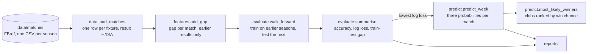

# Architecture

## Data flow

`pipeline.run()` calls these in order. Each step is a function from data
frames to a data frame, so the notebook can run them one at a time.

## The feature

For every match, walk through the history in date order:

1. Each club keeps a list of its goal differences, one per league match.
2. Before a match, its form is the average of the last 50 entries. With
   fewer than 3, the club is treated as new to the league: &minus;0.5.
3. `gap` = home form &minus; away form.
4. Only then is the match's own result added to both lists.

Step 4 coming after step 2 is the leak guard. The first season (2014-15)
only builds up history, so its matches are not used as rows.

Why goal difference and not points: it is less affected by a few lucky or
unlucky results. Why 50 matches: it had the lowest backtest log loss of 10,
20, 34 and 50 (`reports/window_check.csv`). The window crosses season
boundaries, so early in a season a club's form still reflects last season.

## Evaluation

| Set | Seasons | Matches | Used for |
|---|---|:---:|---|
| Backtest | 2016-17 to 2024-25 | 2,176 | Choosing the model and the window |
| Validation | 2025-26 | 306 | Looked at while building; reported, not trusted |
| Test | 2026-27 so far | 94 | Never looked at until the model was fixed |

Each season is predicted by a model trained on every earlier season. A
random split would train on later seasons to predict earlier ones.

The model is chosen by **log loss**, because the probabilities are what the
weekly ranking uses. **Accuracy** is reported too because it is easier to
explain. The baseline, scikit-learn's `DummyClassifier(strategy="prior")`,
always picks the most common result (a home win) and gives every match the
training seasons' result frequencies.

## Why logistic regression

It turns a weighted sum of the input into probabilities for each of the
three results (a softmax over three linear scores). With one input it learns
six numbers: a weight and a constant for each result. It cannot memorise
2,000 matches, and its probabilities are well behaved. The two tree
ensembles are in the comparison to show what happens when a model has far
more freedom than the signal supports.

## Guards against leakage

- `add_gap` reads a club's history before adding the current match.
  `tests/test_features.py` flips every result from 1 January 2024 onwards and
  checks that no earlier gap changes.
- `walk_forward` trains only on earlier seasons. `predict_week` trains only
  on matches before the week's first kick-off.
- The model and the window were chosen on the backtest before the 2026-27
  matches were scored.
