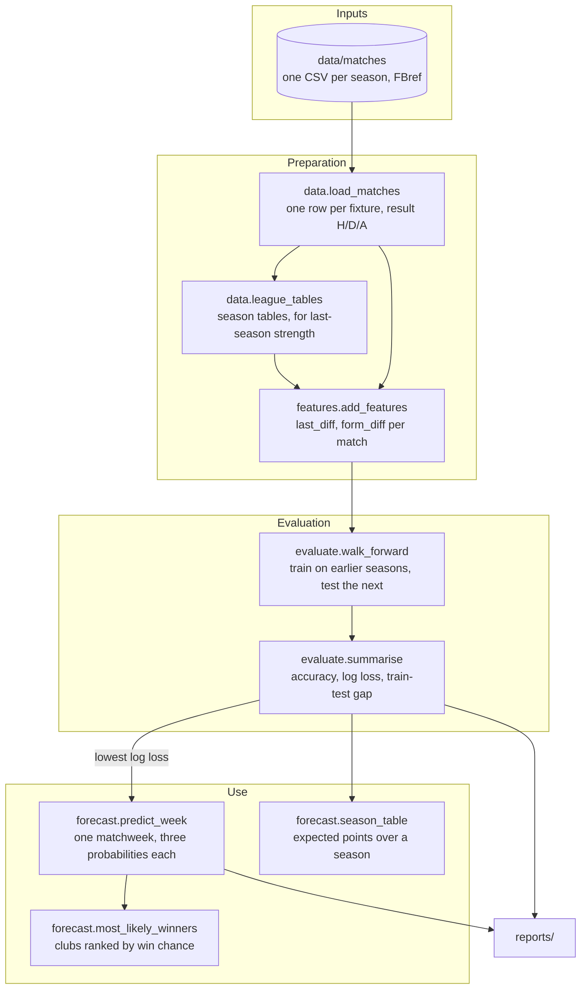

# Architecture

## Data flow

`pipeline.run()` calls these in order. Each box is one function that takes
data frames and returns a data frame, so every step can be run on its own,
which is what the notebook does.

## The modelling table

`add_features` returns one row per match.

| Column | Known before kick-off? | Meaning |
|---|:---:|---|
| `home_last`, `away_last` | yes | Goal difference per game last season |
| `home_form`, `away_form` | yes | Goal difference per game over the last 10 league matches |
| `last_diff`, `form_diff` | yes | Home minus away, for each of the two. These are the model's inputs |
| `result` | no (target) | H, D or A |

The first season (2014-15) has no "last season", so its matches only feed
form. A club with fewer than 3 recent top-flight matches, usually a promoted
side, uses its last-season number for form too.

## Walk-forward backtest

A model is only tested on a season that comes after everything it was trained
on, the same way it would be used for real.

| Test season | Trained on | Test matches |
|---|---|:---:|
| 2016-17 | 2015-16 | 182 |
| 2017-18 | 2015-16 to 2016-17 | 182 |
| ... | ... | ... |
| 2024-25 | 2015-16 to 2023-24 | 306 |
| 2025-26 (holdout) | 2015-16 to 2024-25 | 306 |

Nine backtest seasons, 2,176 matches, choose the model. 2025-26 is scored
once, after the choice. The 2026-27 season is in progress: the next unplayed
matchweek is predicted from everything played before it.

A random split of matches would be wrong here: it would train on 2024-25 to
predict 2019-20, and form features would be computed from matches that come
after the ones being predicted.

## Design decisions

**Predict matches, not tables.** Ten seasons of tables give about 100
club-seasons to learn from; ten seasons of matches give about 2,800. A match
also has a natural baseline (the home side wins 44% of the time) and can be
checked every week.

**Two features, in goals per game.** Goal difference is a steadier measure of
strength than points, which depend on a few lucky or unlucky results. Per
game, because seasons have had 26, 30 and 34 matches per club. Last season
gives a stable view; the last 10 matches react to changes, including during
the current season. Both are differences (home minus away), so the model sees
how far apart the two teams are.

**Logistic regression.** It turns a weighted sum of the inputs into
probabilities for the three results. With two inputs it has 9 numbers to
learn (a weight per input and a constant, for each of the three results) and
cannot memorise 2,000 matches. The tree ensembles are there to show what
happens when a model has more freedom than the signal supports.

**Choose by log loss, report accuracy too.** Log loss judges the
probabilities, which is what the weekly rankings and the season table use.
Accuracy is easier to explain. Both are reported.

**Season table as a by-product.** Expected points per match, 3 &times; P(win)
+ P(draw), summed over a season's fixtures with the season's own results
hidden. It is reported, with its weaker seasons, but it is not what the model
was chosen for.

## Guards against leakage

- Features for a match use only results from earlier dates.
  `tests/test_features.py` swaps every result from 1 January 2024 onwards and
  checks that no earlier match's features change.
- `walk_forward` trains only on earlier seasons; `predict_week` trains only on
  matches before the week's first kick-off.
- `season_table` hides the season's results before building its features, so
  form cannot update during a season it is forecasting.
- The model is chosen before 2025-26 is scored.
