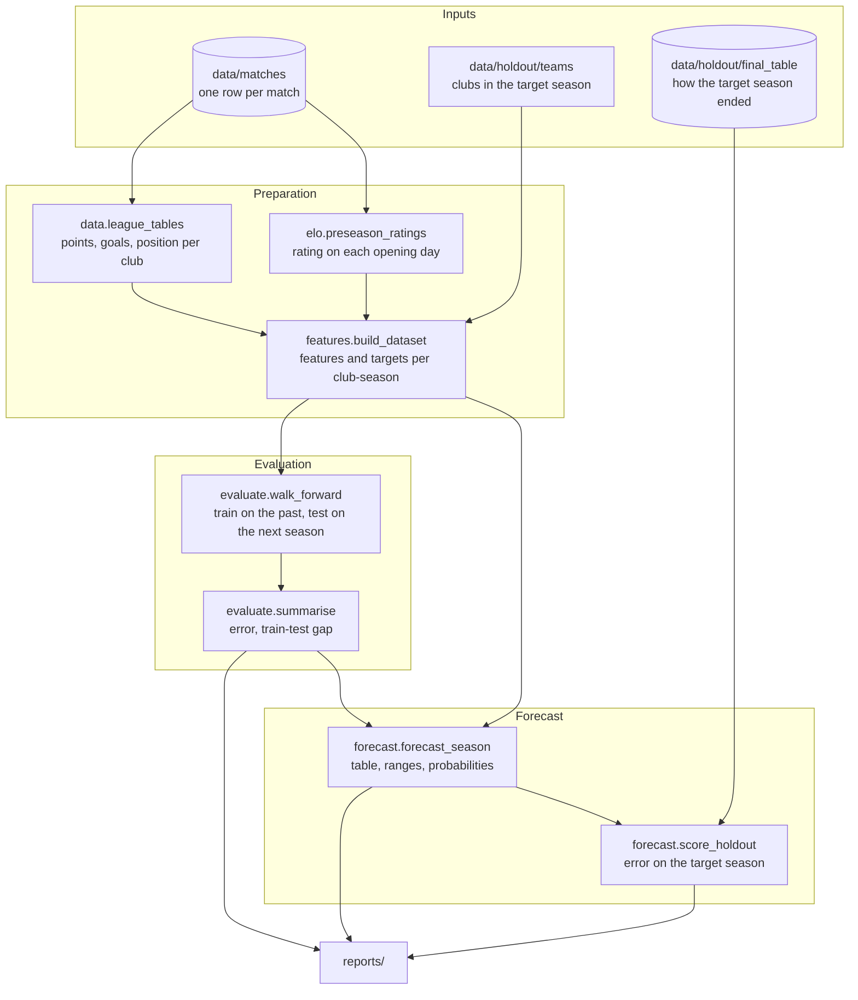

# Architecture

## Data flow

`pipeline.run()` calls these in order. Each box is one function that takes
data frames and returns a data frame, so every step can be run and inspected
on its own, which is what the notebook does.

## The modelling table

`build_dataset` returns one row per club per season.

| Column | Known before the season? | Meaning |
|---|:---:|---|
| `prev_ppg`, `prev_gd_pg` | yes | Points and goal difference per game last season |
| `elo` | yes | Elo rating on opening day |
| `promoted` | yes | 1 if the club was not in last season's table |
| `prev_points`, `prev_wins`, ... | yes | Raw totals, used only by the `v1` model |
| `ppg` | no (target) | Points per game this season |
| `position` | no (target) | Final position this season |

Seven seasons of matches give six seasons with a "previous season", so there
are 100 labelled rows. The 2025-26 rows have features and empty targets.

## Walk-forward backtest

A model is only ever tested on a season that comes after everything it was
trained on, the same way it would be used for real.

| Test season | Training seasons | Training rows | Test rows |
|---|---|:---:|:---:|
| 2021-22 | 2019-20, 2020-21 | 32 | 16 |
| 2022-23 | 2019-20 to 2021-22 | 48 | 16 |
| 2023-24 | 2019-20 to 2022-23 | 64 | 18 |
| 2024-25 | 2019-20 to 2023-24 | 82 | 18 |
| 2025-26 (holdout) | 2019-20 to 2024-25 | 100 | 18 |

The first four rows are the backtest and are used to choose a model. The last
row is the holdout: it plays no part in any choice and is scored once.

A random split of rows would be wrong here. It would let a model train on
2024-25 and be tested on 2021-22, and it would put clubs from the same season
on both sides of the split.

## Design decisions

**Predict points per game, then rank.** League position is the thing we care
about, but it is an awkward target: it is ordinal, it depends on what every
other club does, and its scale changes when the league grows from 16 to 18
clubs. Points per game is continuous and means the same thing in every
season. Ranking the predictions gives the table.

**Elo as a feature.** A season's table compresses 30 or more matches per club
into one row. Elo uses each match as it happens and carries a club's rating
from one season into the next, so it holds more of the history than last
season's table alone. Its four settings are conventional values and were not
tuned on this data.

**Promoted clubs.** A promoted club has no previous top-flight season. Its
`prev_*` features are filled with the average of the previous season's bottom
three, and the `promoted` flag lets a model correct for that. A club that has
been in the league before keeps its old Elo rating, pulled toward the mean for
each summer it was away; a club never seen before starts at 1400.

**Small models first.** With 100 rows, the comparison is ordered from no
parameters (baseline) to two (Elo) to five (Ridge) before anything flexible.
The tree ensembles are there to show what happens when a model has more
capacity than the data can support.

**Uncertainty.** The forecast simulates 10,000 seasons. In each one, every
club's predicted points per game is nudged by random noise with the same
spread as the model's backtest errors, and the league is re-ranked. Position
ranges and probabilities are read off those simulations.

## Guards against leakage

- Features for season *N* are built only from seasons before *N*.
  `tests/test_features.py` rewrites every result from a season onwards and
  checks that the season's features do not change.
- `walk_forward` trains only on seasons before the test season.
  `tests/test_evaluate.py` asserts it.
- Ridge chooses its penalty by cross-validation inside the training seasons.
- The model is chosen in `pipeline.run()` before `load_final_table` is called.
  The forecast code path never reads the final table.
